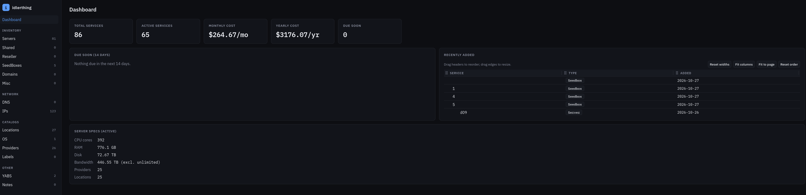
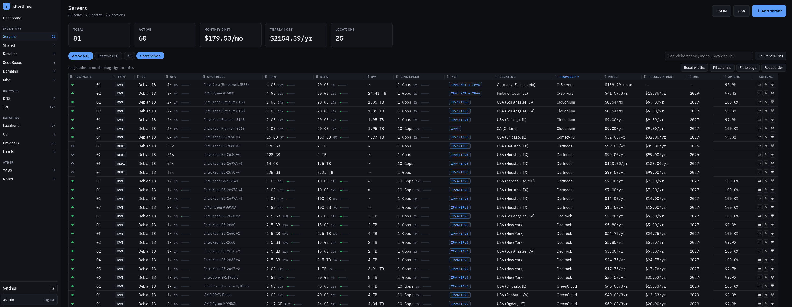

# idlerthing

A lightweight, single-binary, self-hosted inventory for hosting services —
inspired by my-idlers, reimplemented in Go. Track servers, shared hosting,
reseller hosting, seedboxes, domains, and misc services with pricing and
due-date awareness, labels, notes, IPs (with whois), DNS records, and YABS
benchmarks. SQLite storage, no cgo, no external services required.

## Features

- **Inventory** — six service types with dense, htmx-powered list pages
  (search, sort, status tabs), forms, and detail pages.
- **Dashboard** — monthly cost (converted via live exchange rates), due-soon
  list with automatic due-date rollover, recently added, spec summary.
- **Labels, notes, IPs, DNS** — attachable to every service; whois refresh
  via ipwho.is; lazy due-date advancement.
- **Settings** — currencies, due-soon window, theme (dark/light), password
  change, API token management.
- **JSON API** — Bearer-token read access to everything, full CRUD for
  servers, paginated.
- **Export/import** — full JSON export and CSV zip; restore with
  `idlerthing import`.
- **YABS** — signed ingest URLs (or paste) for yabs.sh results, a
  per-server dashboard of its history, and a fleet overview with provider
  statistics.
- **Public page** — optional read-only `/public` server list.

## Screenshots

Dashboard: monthly and yearly cost, due-soon list, recently added, spec summary.



Servers list: dense grid with per-column drag/resize, status tabs, and usage bars.
Hostnames and due dates are partially blanked in this capture.



## Quick start

```sh
make build
./idlerthing
# open http://127.0.0.1:8080 — log in as admin@localhost
```

On first run an admin user is created with a generated password, printed to
stderr **once** (look for `First run: admin password is ...`). To choose the
password instead, set `IDLER_ADMIN_PASSWORD` (min 8 chars) before the first
start.

## systemd

`idlerthing.service` (repo root) runs the app as a hardened dynamic user:

```sh
sudo install -m 0755 idlerthing /usr/local/bin/idlerthing
sudo install -m 0644 idlerthing.service /etc/systemd/system/idlerthing.service
sudo install -d -m 0750 /etc/idlerthing
sudo install -m 0600 /dev/null /etc/idlerthing/idlerthing.env
sudo systemctl daemon-reload
sudo systemctl enable --now idlerthing
```

The env file stays empty unless you want to set variables explicitly. On
first start a generated admin password is printed once — retrieve it with:

```sh
sudo journalctl -u idlerthing | grep 'admin password'
```

The database lands in `/var/lib/idlerthing/data/` (default `IDLER_DB` is
relative to the unit's `WorkingDirectory`). See the comments in the unit file
for memory limits, hardening notes, and the `CAP_NET_RAW` caveat for the
in-app ping tool.

## Docker

Each release also publishes a multi-arch (`linux/amd64`, `linux/arm64`) image
to `ghcr.io/alteredparadox/idlerthing`, tagged `X.Y.Z`, `X.Y` and `latest`. It
is the same static binary on Alpine. It runs as uid 10001 and keeps the
database and the generated YABS secret in the `/var/lib/idlerthing` volume.

[`deploy/docker/docker-compose.yml`](deploy/docker/docker-compose.yml) runs it
hardened: a read-only root, no capabilities and `no-new-privileges`. The port is
published on `127.0.0.1:8080` only, for a reverse proxy on the host to front:

```sh
cd deploy/docker
docker compose up -d
docker compose logs idlerthing | grep 'admin password'   # first run only
```

The image sets `IDLER_ADDR=0.0.0.0:8080` (inside the container) and
`IDLER_DB=/var/lib/idlerthing/data/idlerthing.db`. Other variables from
[Configuration](#configuration) go in the compose `environment:` block, or in
an optional `deploy/docker/idlerthing.env` (mode 0600) for secrets such as
`IDLER_ADMIN_PASSWORD`. The subcommands work through `exec`:

```sh
docker compose exec idlerthing idlerthing version
docker compose exec idlerthing idlerthing passwd     # generates and prints a new password
docker compose exec -T idlerthing idlerthing passwd < password.txt   # or supply your own
docker compose exec -T idlerthing idlerthing import /dev/stdin < backup.json
```

`import` reads the backup from standard input. `docker compose cp` into the
container fails, because the root filesystem is read-only.

Notes:

- **Behind a proxy is the supported shape.** The compose file sets
  `IDLER_BEHIND_TLS_PROXY=1`. The host proxy's connections to
  `127.0.0.1:8080` arrive from the Docker gateway address, so the proxy's
  `X-Forwarded-For` is the only source of the real client address. In this
  mode idlerthing trusts the header's **last** address for login rate limiting
  and fail2ban. That is safe only while the host proxy is the only thing that
  can reach port 8080. That holds when all three of these are true:
  - **Docker Engine 28.0 or newer.** Older engines let other hosts on the same
    L2 segment reach loopback-published ports
    ([Docker docs](https://docs.docker.com/engine/network/port-publishing/#publishing-ports)).
    Check with `docker version`, or firewall the port yourself.
  - **No untrusted containers on idlerthing's network.** Containers on the same
    network bypass the published port. The compose file's network holds only
    idlerthing; keep it that way.
  - **The proxy appends or replaces the final `X-Forwarded-For` entry** with
    the address it saw. Caddy's `reverse_proxy` does this by default, and so
    does nginx with
    `proxy_set_header X-Forwarded-For $proxy_add_x_forwarded_for`.

  To serve plain HTTP on a LAN without a proxy, publish the port on the LAN
  address and **remove** `IDLER_BEHIND_TLS_PROXY`. Otherwise any client could
  forge the header, and session cookies would be `Secure`-only over HTTP.
- **The ping tool works** without `CAP_NET_RAW`. Docker allows unprivileged
  ICMP sockets by default (`net.ipv4.ping_group_range`), unlike the hardened
  systemd unit.
- **fail2ban** stays on the host. The compose file logs to journald with
  `tag: idlerthing`, which the shared filter matches unchanged. Install
  [`deploy/docker/fail2ban-jail.local`](deploy/docker/fail2ban-jail.local) in
  place of the systemd jail (`sudo fail2ban-regex -m CONTAINER_NAME=idlerthing
  systemd-journal /etc/fail2ban/filter.d/idlerthing.conf` checks it). Its
  comments cover the `DOCKER-USER` case for a publicly published port.
  On a host without journald (Docker Desktop, non-systemd distros), delete the
  compose `logging:` block, because the container won't start with it.
- **Backups:** the `idlerthing_data` volume holds the whole state. Use the
  export/import below, or stop the container and copy the volume.
- **Package visibility:** the release workflow checks that each image tag is
  anonymously pullable before it cuts the Release. If GHCR ever creates the
  package as private, the run stops there. Set the package to public once
  (package settings → Change visibility), then re-run the failed jobs. The
  re-push is idempotent.
- **Build locally:** `make docker` builds `idlerthing:local`, stamped with
  `git describe`. Run it with
  `IDLERTHING_IMAGE=idlerthing:local docker compose up -d`.

## Banning brute-force logins (fail2ban)

idlerthing logs authentication events to stderr — the systemd journal — in a
fail2ban-friendly form. The binary calls `log.SetFlags(0)` because journald
already stamps every entry, so the logged message is exactly:

```
WARN login: failed authentication from=203.0.113.7 user=someone@example.com
WARN login: rate-limited from=203.0.113.7
WARN login: failed password-change verification from=203.0.113.7
INFO login: authenticated from=203.0.113.7 user=admin@localhost
```

The attempted username is attacker-controlled, so it is only ever emitted
**after** the address (and slog escapes it) — a crafted value cannot shift the
filter's `<ADDR>` capture. fail2ban's systemd backend presents each entry as
`host idlerthing[pid]: message`; the filter's prefix pattern absorbs that, so
it matches both the journal and a plain log file. Successful logins are
audited in the same stream and excluded by the filter's `ignoreregex`.
Blocked attempts log at most once per minute per source, so a flood of
already-refused requests cannot amplify into unbounded journald writes.

Built-in limits, independent of fail2ban: 10 attempts per minute per source
(shared by the login form and the Settings → Account password change and API
token generation, so a stolen session cannot guess the real password
unthrottled) and 10 per minute per account. The per-account limit spares
addresses that have signed in before, so a stranger hammering the admin
account cannot lock the owner out from a familiar address — it still applies
in full to everyone else. A "source" is an IPv4 address or an IPv6 /64, and
the limiter tracks at most 4096 of them. A flood of more distinct sources
than that is refused without being logged per address (one
`WARN login: limiter saturated` line per minute instead, which the filter
does not match), and addresses that have signed in before keep their own
budget throughout, so the owner can still get in.

A ready-made filter and jail ship in [`deploy/fail2ban/`](deploy/fail2ban):

```sh
sudo install -m 0644 deploy/fail2ban/idlerthing.conf /etc/fail2ban/filter.d/idlerthing.conf
sudo install -m 0644 deploy/fail2ban/jail.local      /etc/fail2ban/jail.d/idlerthing.conf
sudo fail2ban-regex systemd-journal /etc/fail2ban/filter.d/idlerthing.conf  # expect matched > 0 once a failed login is in the journal
sudo systemctl restart fail2ban
sudo fail2ban-client status idlerthing
```

> **The address is only the real client when the deployment says so.** It is
> idlerthing's rate-limiter key, which trusts `X-Forwarded-For` only with
> `IDLER_BEHIND_TLS_PROXY=1`. Without that, behind a reverse proxy, every line
> carries the *proxy's* address — and banning it locks out everyone. Fix the
> config before enabling the jail.

The jail bans with the native `nftables` backend, since Debian 13 ships no
iptables by default, and covers TCP and UDP so a ban also applies over QUIC.

## Configuration

| Variable              | Default                  | Purpose                                  |
| --------------------- | ------------------------ | ---------------------------------------- |
| `IDLER_ADDR`          | `127.0.0.1:8080`         | HTTP listen address                      |
| `IDLER_DB`            | `./data/idlerthing.db`   | SQLite file path                         |
| `IDLER_ADMIN_PASSWORD`| *(none)*                 | First-run admin password (seed only)     |
| `IDLER_SECRET`        | *(generated)*            | YABS ingest HMAC key; persisted to `<db>.secret` when unset |
| `IDLER_BEHIND_TLS_PROXY` | *(off)*             | Set `1`/`true`/`yes` behind an HTTPS-terminating proxy: session cookies go `Secure` and the last `X-Forwarded-For` IP is trusted |
| `IDLER_BASE_URL`      | *(none)*                 | External URL used in the YABS ingest command (default: request scheme+Host). Set it behind a reverse proxy so the command never depends on the request's `Host` |
| `IDLER_ALLOW_HTTP_INGEST` | *(off)*              | Allow plain-http YABS ingest URLs on LAN hosts (loopback http and https always work) |

## Backup & restore

- Export in the UI (JSON per type or full, CSV zip) or via
  `GET /export/json`. Per-type JSON exports are **partial** — they omit
  related records (pricings/ips/dns/notes/labels/yabs) and are marked
  `"partial": true`; only a full export restores everything.
- Restore: `idlerthing import [--force] backup.json` — imports the app's own
  export format. Current exports carry a `"format": 1` envelope marker;
  older backups without one restore as **legacy format** (with a warning),
  while an unrecognized marker is rejected. Catalogs are merged by name;
  services are always inserted fresh, so importing into a non-empty
  database requires `--force` (and duplicates services). Users, sessions,
  and settings are never imported.

## Upgrading

- **v0.4.4 — reinstall the fail2ban filter if you use it.** Earlier versions
  of `deploy/fail2ban/idlerthing.conf` anchored on the bare message, but
  fail2ban's systemd backend presents each journal entry as
  `host idlerthing[pid]: message`, so the jail never matched anything. The
  fixed filter is not picked up by upgrading the binary; copy it into place
  and check it against the journal:

  ```sh
  sudo install -m 0644 deploy/fail2ban/idlerthing.conf /etc/fail2ban/filter.d/idlerthing.conf
  sudo fail2ban-regex systemd-journal /etc/fail2ban/filter.d/idlerthing.conf
  sudo systemctl restart fail2ban
  ```

  The same release makes **Settings → API token** ask for your current
  password before generating a token.
- Early docs showed example admin passwords verbatim. If your deployment
  dates from that era, the server logs a loud warning at startup when the
  admin password matches one — reset it with `idlerthing passwd` (prints a
  generated one), supply a new password through the command's standard input,
  or use **Settings → Account**. Password arguments are rejected because
  other local users may be able to see command lines. All sessions and the API
  token are revoked either way.

## JSON API

Generate a token in **Settings → API token** (it asks for your current
password), then:

```sh
curl -H "Authorization: Bearer $TOKEN" http://127.0.0.1:8080/api/servers
```

- Read: `/api/servers`, `/api/shared`, `/api/reseller`, `/api/seedboxes`,
  `/api/domains`, `/api/misc`, `/api/pricings`, `/api/ips`, `/api/dns`,
  `/api/labels`, `/api/notes`, `/api/providers`, `/api/locations`, `/api/os`
  (lists paginate with `?page=&per=`).
- Write (servers only): `POST /api/servers`, `PUT /api/servers/{id}`,
  `DELETE /api/servers/{id}`.
  `PUT` replaces the server, except `keep`, `initial_price`, `initial_term`
  and `initial_currency`: when left out they keep their stored values, so
  older clients don't reset them. A blank (`null`) initial price is filled
  with the current price, term and currency on save, like the web form does.

## YABS ingest

Every server detail page shows a signed command (also on **YABS → ＋ Add
run**):

```sh
curl -fsSL --proto '=https' https://yabs.sh | bash -s -- -s 'https://your-host/api/yabs/1?sig=...&ts=...'
```

Run it on the server; the benchmark (system info, geekbench, fio disk
speeds, iperf network speeds) appears under **YABS**. Signatures are
HMAC-SHA256 over `{server_id}.{ts}` — valid for 2 hours, single-use
(after a run lands, refresh the page for a fresh command);
duplicate submissions are ignored.

A result you already have can be added without the signed URL: run
`yabs.sh -j` (or `-w file`) and paste the JSON into **＋ Add run**. Both
paths store a run the same way.

The raw JSON of each run is kept next to the parsed values (**Raw JSON** on
the run's page, and in the JSON backup), so fields idlerthing does not read
yet are not lost. Runs ingested before this was added have no raw copy, nor
does a result that is not valid UTF-8 (it is still parsed and stored). A
result yabs.sh could not measure — an iperf endpoint reporting `busy` — is
stored as missing rather than as 0.

### Tracking a server over time

A server's **YABS** page is a dashboard of its run history rather than a
list:

- Six headline tiles (Geekbench single and multi, disk 4k and 1m, network
  send and receive) with the latest value, the change against the previous
  run and against the server's own median, and a trend line.
- A history table with per-run changes. A value 15% or more below the
  server's median is flagged **low**; a median is used once there are three
  runs. Changes under 5% are shown but not coloured — that is ordinary
  run-to-run noise.
- A note when the CPU model, core count or RAM differs from the previous run
  (the host may have been moved to other hardware), and a quieter one for a
  kernel or distro change.
- The latest run's disk and network results broken down by block size and
  by iperf location, each against its own history.
- Tick two runs to compare them side by side.

Geekbench scores are only compared within one major version; a run made with
another version, or one that does not record its version, is listed but left
out of the statistics.

The network tiles show the median across the iperf locations a run actually
measured, and compare two runs only when they measured the same locations: a
run in which some were busy is shown but not marked down against the others.
The per-location breakdown follows each location on its own.

### The fleet overview

**YABS** in the sidebar opens an overview of the active servers:

- **Need a look** — servers whose latest run is 15% or more below their own
  median, or whose hardware changed since the run before.
- **Recent runs** — the newest runs across all servers, each against the
  same server's previous run. **All runs** has the complete list.
- **Providers** — per provider, the median across its servers of each
  server's latest run, the median monthly cost, and single-core points per
  unit of monthly cost. Costs come from each server's active recurring
  price, in the dashboard currency when a rate is available.
- **Same CPU, different providers** — CPU models found at two or more
  providers, each provider's single-core median against the model's.
- **Servers** — every benchmarked server's latest run, fastest single-core
  first.
- **Not benchmarked lately** — active servers with no run in 180 days.

"Latest run" is meant literally: a metric a server's latest run did not
measure is shown as missing, not carried over from an older run. Fleet
statistics compare Geekbench scores on the version most servers use; a score
on another version, or with no version recorded, is listed with a marker
(`900 · v5`) and left out of the medians.

## Tech notes

- Go stdlib only: `net/http`, `html/template`, `embed` — plus
  `modernc.org/sqlite` (pure-Go SQLite, no cgo) and
  `golang.org/x/crypto/bcrypt`.
- htmx + hand-rolled CSS (IBM Plex Sans/Mono, dark & light themes), strict
  CSP, no JavaScript framework.
- Single writer connection (`SetMaxOpenConns(1)`), WAL mode, hand-rolled
  `PRAGMA user_version` migrations.
- All size/bandwidth values are stored in whole MB, 1024-based
  (1 GB = 1024 MB, 1 TB = 1024 GB); the UI enters/displays friendly units
  and converts server-side. NULL bandwidth means unlimited (∞).

## Security model and accepted risks

idlerthing is a single-administrator tool. The one account owns everything,
has shell access to the host it runs on, and is the only principal the
application knows; there is no multi-tenant or privilege boundary inside it.
The boundaries it does defend are: anonymous network clients against the
login form and the YABS ingest, cross-site pages against the signed-in
browser, and the host-side service account against the rest of the system
(see the systemd unit). Security audits in November 2026 confirmed and fixed
four issues (login-limiter lockout, logout failing open on a database error,
an open redirect through a control character in the Referer, and
`X-Forwarded-For` being read from the wrong header line). The following
leads from those audits are **accepted as designed** and are not planned
fixes:

- **The dashboard GET rolls overdue billing dates forward.** A cross-site
  link to `/` can trigger it, but all it does is the deterministic catch-up
  the next dashboard visit would do anyway. No attacker-chosen data is
  involved.
- **The first-run admin password is printed to the journal.** That is how
  it reaches you (see *systemd* above). Change it after the first login if
  journal readers other than you exist.
- **The Prometheus URL and the fixed outbound services (rates, whois) may
  reach internal hosts.** Only the administrator can set the Prometheus URL,
  and the administrator already has the host. No network-authority
  separation between the service and its operator is claimed.
- **The YABS command is `curl https://yabs.sh | bash`.** It runs on the
  benchmarked server, not on idlerthing, and it is how YABS is distributed.
  Review it there if you do not trust the publisher.
- **The YABS command's URL derives from the request `Host` unless
  `IDLER_BASE_URL` is set.** Set it behind a proxy. An invalid value is
  logged at startup and ignored.
- **Releases publish on any `v*` tag and are unsigned.** Only repository
  owners can push tags. The checksum file is built in the same job as the
  binaries.
- **The SonarQube job runs the test suite before the token-bearing step on
  same-repository pull requests.** Only repository writers can open those.
- **Import warnings echo file content to the terminal.** The operator chose
  the file; the CLI does not sanitise terminal control sequences in it.
- **Smaller notes, accepted as-is:** the API accepts a bare token as well as
  `Bearer <token>`; zoned IPv6 addresses are accepted in imports and ping
  targets; the YABS `gb_url` link is not restricted to geekbench.com; the
  secret file is read after a separate `Lstat` (the data directory is
  private to the service user); bcrypt work is bounded per source, not
  globally; `govulncheck` and the browser-test Playwright are fetched
  unpinned; htmx history snapshots and grid preferences stay in the
  browser after logout (clearing them would also wipe the grid layout).

Report anything outside this list through the repository's issue tracker.

## License

idlerthing is free software under the **GNU Affero General Public License v3
or later** ([`LICENSE`](LICENSE)).

The AGPL's §13 obligation is to offer the Corresponding Source to everyone who
interacts with the program *over a network*, so these three routes are
deliberately **unauthenticated** — a login wall would defeat the offer:

| Route | Serves |
| --- | --- |
| `/license` | the AGPL text embedded in this binary |
| `/third-party-licenses` | every bundled dependency's licence and notices |
| `/source` | redirects to the Corresponding Source, pinned to the running version |

They are linked from the login page and from **Settings → About & licensing**.
A stamped release points `/source` at its own tag, so the source you are
offered is the source that is running; an unstamped build can only point at
the repository.

`THIRD_PARTY_LICENSES.md` is generated from the modules **actually linked into
the binary** (read back off a probe build) plus the embedded front-end assets,
whose licence texts are vendored in `internal/web/assets/vendor/` beside them:

```sh
make notices        # regenerate (also runs automatically as part of `make build`)
make notices-check  # fail if the committed copy is stale
```

`make build` regenerates it, so what ships always matches what is linked in.
`notices-check` gates the **release** workflow rather than every PR: Dependabot
bumps `go.mod` but cannot regenerate the file, and gating PRs on it would make
every dependency PR red for a reason the bot cannot fix.

Every first-party source file carries the AGPL notice; `make license-check`
(part of CI) fails if one is missing, and `make license-headers` adds it.

## Development

Grid columns can be resized using their right edges and reordered by dragging
their headings or grips. Widths and order are remembered in this browser for
each user and grid. Actions stays last. Reset widths and Reset order work
independently. Fit columns sizes each column to its widest visible cell; Fit
to page does the same and then widens the columns to fill the page without a
horizontal scrollbar (it is greyed out when the content alone is already
wider than the page). The resize controls also support Left/Right (Shift for larger
steps) and Home; the move grips support Left/Right and Home/End.

The browser regression check for the grids uses synthetic tables and does not
require a running instance or a database. CI runs it as the `grid` job; to run
it locally with Node.js installed:

```sh
grid_test_deps=$(mktemp -d)
npm install --prefix "$grid_test_deps" playwright
"$grid_test_deps/node_modules/.bin/playwright" install chromium
NODE_PATH="$grid_test_deps/node_modules" node scripts/test-grids.cjs
```

```sh
make build   # trimmed static binary
make run     # go run .
make test    # go test ./...
make vet     # gofmt -l + go vet ./...
make license-check    # every first-party source carries the AGPL notice
make license-headers  # ...add it to any that don't
make notices          # regenerate THIRD_PARTY_LICENSES.md
make notices-check    # fail if it is stale (gates the release workflow)
make clean
```
